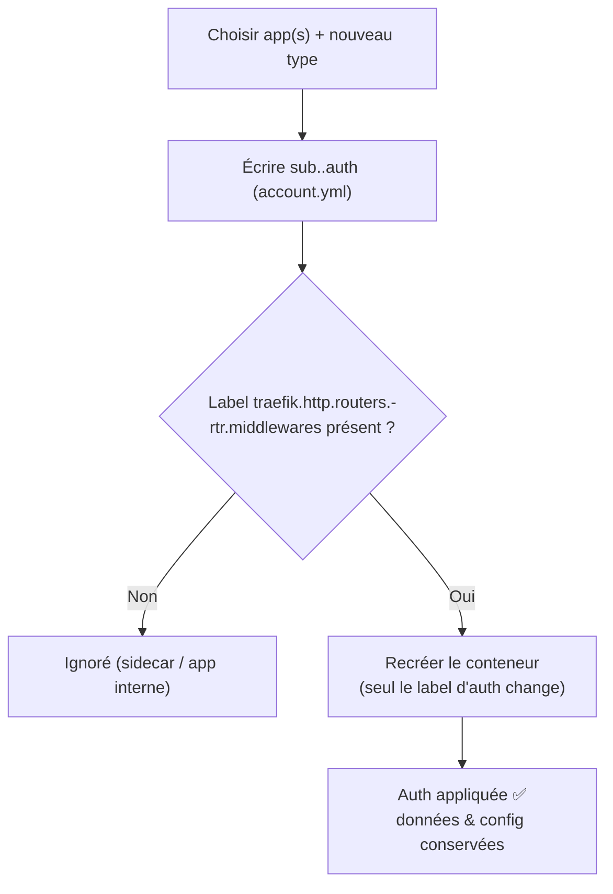

!!! abstract "Abstract"
    Chaque application exposée derrière Traefik possède un **type d’authentification**.  
    Cette page explique **comment le changer** (menu SSDV2 ou `ssdv2ctl`) et **comment il est appliqué** : SSDV2 ne modifie que le **label Traefik du router principal** de l’application, puis recrée le conteneur — **sans rejouer le playbook** (donc sans risque lié aux tâches de configuration applicatives).

---

## TL;DR

- 🔐 Types : `aucune`, `basique`, `oauth`, `authelia`, `oauth2-proxy`.
- 🖥️ Menu : **Gestion → Gestion de l’authentification des applications** (sélection multi-apps, choix du type, application).
- 🧰 CLI : `ssdv2ctl auth set <app> <type>` (écriture) puis `ssdv2ctl auth apply <app>` (application), ou directement `ssdv2ctl auth apply <app> <type>`.
- 🏷️ Application = modifier le label `traefik.http.routers.<app>-rtr.middlewares` → `chain-<auth>@file`.
- ♻️ Le conteneur est **recréé** (labels Docker immuables) mais **sans playbook** ; données et reste de la config conservés.
- 🧩 Les **routers secondaires** (bypass API, routes publiques…) sont **conservés** ; les conteneurs sans router `<app>-rtr` (sidecars) sont **ignorés**.

---

## Les types d’authentification

| Type | Chaîne de middlewares Traefik | Usage |
|---|---|---|
| `aucune` | `chain-no-auth@file` | service public / derrière une autre couche |
| `basique` | `chain-basic-auth@file` | login/mot de passe htpasswd |
| `oauth` | `chain-oauth@file` | OAuth (Google, legacy) |
| `authelia` | `chain-authelia@file` | Authelia |
| `oauth2-proxy` | `chain-oauth2-proxy@file` | oauth2-proxy (SSO) |

!!! tip "Quel type choisir ?"
    Le type dépend de l’authentification **globale** de votre Traefik (voir la page **Mise en place Google OAuth2 — Traefik**). En général, toutes les applis partagent la même stratégie ; vous pouvez en mettre une en `aucune` ou en `basique` pour une exception.

---

## Comment c’est appliqué (label-only, sans playbook)

Le type d’auth d’une application se traduit par **un seul label** sur son conteneur :

```text
traefik.http.routers.<app>-rtr.middlewares = chain-<auth>@file
```

L’application du changement :

1. calcule la chaîne cible (`chain-<auth>@file`) ;
2. **recrée le conteneur à l’identique** en ne modifiant **que ce label** (config, volumes, réseau, ports… conservés) ;
3. ne lance **aucun** playbook SSDV2 ni tâche de configuration.

!!! success "Pourquoi c’est important"
    Recréer un conteneur uniquement pour changer un **label Traefik** évite de rejouer la **recette** de l’application (qui, pour certaines apps, peut toucher à la configuration). C’est plus sûr et plus rapide, et les **données sont conservées**.

!!! warning "Un redémarrage ne suffit pas"
    Le changement de type d’auth modifie un **label Docker** : il faut **recréer** le conteneur (les labels sont immuables). Un simple `restart` ne l’applique pas.

---

## Via le menu SSDV2

Menu principal → **Ajout/Suppression/Sauvegarde d’application** ou **Utilitaires** → **Gestion de l’authentification des applications** (script `manage_auth.py`).

Le menu permet de :

- **sélectionner plusieurs applications** ;
- choisir le **nouveau type d’authentification** ;
- écrire la valeur dans `account.yml` (Vault) ;
- **appliquer** aux applications modifiées (recréation **label-only**, sans playbook).

!!! info "Une seule valeur dans account.yml"
    Le type d’auth est stocké dans `account.yml` sous la clé `sub.<app>.auth`. Les interfaces (menu, `ssdv2ctl`) écrivent cette clé puis appliquent.

---

## Via ssdv2ctl

=== "Écrire puis appliquer"
    ```bash
    ssdv2ctl auth set sonarr authelia   # écrit sub.sonarr.auth
    ssdv2ctl auth apply sonarr          # applique (label-only)
    ```

=== "Écrire + appliquer en une commande"
    ```bash
    ssdv2ctl auth apply sonarr authelia
    ```

=== "Appliquer l’auth déjà enregistrée"
    ```bash
    ssdv2ctl auth apply sonarr
    ```

=== "Plusieurs applications"
    ```bash
    ssdv2ctl auth set-many oauth2-proxy radarr sonarr
    ssdv2ctl auth apply radarr
    ssdv2ctl auth apply sonarr
    ```

**Vérifier :**

```bash
ssdv2ctl auth get sonarr
ssdv2ctl auth list
```

Le label réellement posé sur le conteneur est visible avec :

```bash
docker inspect sonarr \
  --format '{{ index .Config.Labels "traefik.http.routers.sonarr-rtr.middlewares" }}'
```

---

## Cas particuliers

!!! note "Routers secondaires conservés"
    Certaines applications déclarent **plusieurs routers** (par ex. un router **bypass API** en `chain-no-auth`, une route **publique**, etc.). L’application du type d’auth ne modifie **que** le router principal `<app>-rtr` : les autres routers sont **laissés tels quels**.

!!! note "Conteneurs sans router (sidecars)"
    Les conteneurs compagnons (`db-<app>`, `redis-<app>`…) n’ont pas de router `<app>-rtr` : ils sont **ignorés** (aucune recréation).

!!! note "Applications internes"
    Une application purement interne (non exposée via Traefik) n’a pas de label `<app>-rtr` : le changement d’auth ne s’y applique pas.

---

## Diagramme



---

## Voir aussi

- **Mise en place Google OAuth2 — Traefik** (`Installation/oauth.md`) : configuration du client Google, whitelist, bypass API.
- **`ssdv2ctl`** (`Installation/ssdv2ctl.md`) : commandes `auth get|set|apply|list|set-many`.
- **Cycle de vie** (`Installation/ajouter-supprimer-reinitialiser.md`) : `restart` / `update` / `recreate` / `reinstall`.
