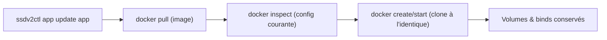
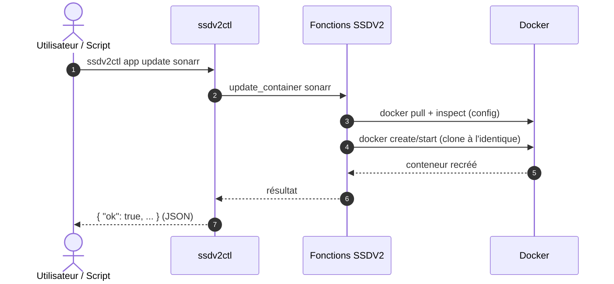

!!! abstract "Abstract"
    **`ssdv2ctl`** est l’interface **en ligne de commande, non interactive et JSON** du moteur SSDV2.  
    Elle permet de **lire l’état** (catalogue, statut, auth, config) et de **lancer des actions** (démarrer/arrêter/redémarrer, installer/supprimer/réinstaller/recréer/**mettre à jour**, sauvegarder, changer l’authentification) **sans passer par le menu**, pour un usage scripté (CI, WebUI, automatisation).

    Elle ne réinvente rien : elle **réutilise les fonctions et les sources de vérité de SSDV2** (catalogue, `ssddb`, registres, `account.yml`).

---

## TL;DR

- 🧰 Binaire unique : `~/seedbox-compose/ssdv2ctl` (Python, sans dépendance externe).
- 📦 Sortie **JSON** sur `stdout`, erreurs JSON sur `stderr`, codes de sortie `0/1/2`.
- 📚 Lecture : `apps list`, `app status`, `auth get`, `auth list`, `config get|list`, `diagnostics run`.
- ⚙️ Cycle de vie : `app start|stop|restart|install|remove|reinstall|recreate|update|backup`.
- ⬆️ **`app update`** : met à jour l’image des conteneurs **sans rejouer le playbook** (pull + recréation à l’identique).
- 🔐 **`auth apply`** : applique l’authentification en ne changeant que le **label Traefik** du router principal (sans playbook).
- 🚫 Aucune invite : si une valeur manque dans `account.yml`, la commande échoue avec `interactive_required`.

---

## Présentation

`ssdv2ctl` vit **dans le dépôt SSDV2** :

```bash
~/seedbox-compose/ssdv2ctl --version
# ssdv2ctl 0.5.0
```

Il est **non interactif** : toutes les informations sont fournies par les arguments, et tout est renvoyé en **JSON** (pratique pour un script ou une interface). Le **menu interactive** (`./seedbox.sh`) reste la voie « humaine » ; `ssdv2ctl` est la voie « programme ».

!!! info "Pourquoi deux interfaces ?"
    - **Menu** (`seedbox.sh`) : navigation guidée, choix, saisies. Idéal pour un humain.
    - **`ssdv2ctl`** : une commande = une action, réponse JSON. Idéal pour l’automatisation (WebUI, cron, CI).

### Sources de vérité utilisées

`ssdv2ctl` lit et écrit **les mêmes éléments que SSDV2** :

- catalogue : `includes/config/services-available`
- base d’applications : `ssddb`
- registres : `~/seedbox/conf/<app>.containers|.volumes|.dns`
- secrets/état : `account.yml` (chiffré Ansible Vault)
- conteneurs : API/CLI Docker

---

## Sortie JSON et codes

=== "Succès"
    ```json
    { "schema": 1, "app": "sonarr", "action": "update", "ok": true, "exit_code": 0 }
    ```

=== "Erreur"
    ```json
    { "error": { "code": "not_installed", "message": "sonarr n'est pas installé" } }
    ```

Codes de sortie :

| Code | Signification |
|:---:|---|
| `0` | Succès |
| `1` | Erreur d’exécution (action en échec) |
| `2` | Usage invalide (argument/commande) |

!!! note "Codes d’erreur fréquents"
    `unknown_app`, `not_installed`, `already_installed`, `invalid_auth`, `invalid_subdomain`, `no_containers`, `docker_unavailable`, `interactive_required`, `action_failed`.

---

## Commandes de lecture

| Commande | Description |
|---|---|
| `ssdv2ctl apps list` | Liste le catalogue SSDV2 (applications disponibles) |
| `ssdv2ctl app status <app>` | État factuel d’une application (`ssddb`, registres, conteneurs Docker) |
| `ssdv2ctl auth get <app>` | Lit le type d’authentification d’une application |
| `ssdv2ctl auth list` | Liste les applications installées et leur type d’auth |
| `ssdv2ctl config get <clé>` | Lit une clé de configuration supportée |
| `ssdv2ctl config list` | Liste les clés supportées et leurs valeurs |
| `ssdv2ctl diagnostics run` | Contrôles de diagnostic (lecture seule) |

Clés de configuration supportées : `settings.source`, `settings.storage`, `user.domain`, `user.mail`, `user.name`, `oauth_enabled`, `oauth_type`, `rclone.remote`.

---

## Cycle de vie d’une application

| Commande | Effet | Playbook ? | Données conservées |
|---|---|:---:|:---:|
| `app start <app>` | Démarre les conteneurs | Non | Oui |
| `app stop <app>` | Arrête les conteneurs | Non | Oui |
| `app restart <app>` | `docker restart` (⚠️ **pas de mise à jour d’image**) | Non | Oui |
| `app update <app>` | **Pull de l’image + recréation à l’identique** | **Non** | Oui |
| `app recreate <app>` | Recrée en **rejouant le playbook** (recette `.yml`) | Oui | Oui |
| `app reinstall <app>` | Supprime (données conservées) puis réinstalle | Oui | Oui |
| `app install <app>` | Installe l’application | Oui | — |
| `app remove <app>` | Supprime l’application (`--delete-data` pour les données) | Oui | Selon mode |
| `app backup <app>` | Sauvegarde l’application | Non | Oui |

!!! warning "Ne pas confondre `restart`, `update` et `recreate`"
    - **`restart`** : redémarre le conteneur **existant**, **sans tirer de nouvelle image**.
    - **`update`** : tire la dernière image et **recrée le conteneur à l’identique** (config/volumes/réseau conservés), **sans rejouer la recette** (`.yml`).
    - **`recreate`** : recrée en **rejouant le playbook** SSDV2 (utile pour appliquer une modification de `.yml`, de labels, etc.).

---

## Mettre à jour une application (image seule)

```bash
ssdv2ctl app update sonarr
```

- tire (`docker pull`) la/les image(s) des conteneurs de l’application ;
- **recrée chaque conteneur à l’identique** : variables d’environnement, labels, points de montage/binds, **volumes nommés réutilisés**, réseau, ports, politique de redémarrage, devices, healthcheck… ;
- **sans** exécuter le playbook ni les tâches de configuration SSDV2.

!!! success "Sûr par construction"
    Comme la recette SSDV2 n’est **pas** rejouée, cette opération n’expose pas aux tâches de configuration applicatives. Les **données** (volumes nommés et binds) sont **conservées**.



!!! info "Disponible depuis le menu"
    La même opération existe dans le menu : **Ajout/Suppression/Sauvegarde d’application → « Mettre à jour Application (image seule) »**.
    En CLI interne, elle appelle la fonction SSDV2 **`update_container <app>`**.

---

## Gestion de l’authentification

| Commande | Effet |
|---|---|
| `ssdv2ctl auth get <app>` | Lit le type d’auth courant |
| `ssdv2ctl auth list` | Liste les applications installées + leur auth |
| `ssdv2ctl auth set <app> <type>` | **Écrit** `sub.<app>.auth` dans `account.yml` (n’applique pas encore) |
| `ssdv2ctl auth set-many <type> <app…>` | Écrit l’auth pour plusieurs applications |
| `ssdv2ctl auth apply <app> [<type>]` | **Applique** l’auth (écrit `account.yml` si `<type>` fourni, puis recrée le router) |

Types acceptés : `aucune`, `basique`, `oauth`, `authelia`, `oauth2-proxy`.

```bash
# Changer puis appliquer en une seule commande
ssdv2ctl auth apply sonarr authelia

# Appliquer l’auth déjà présente dans account.yml
ssdv2ctl auth apply sonarr
```

`auth apply` modifie **uniquement** le label du router principal :

```text
traefik.http.routers.<app>-rtr.middlewares = chain-<auth>@file
```

- `aucune` → `chain-no-auth@file`
- `basique` → `chain-basic-auth@file`
- `oauth` → `chain-oauth@file`
- `authelia` → `chain-authelia@file`
- `oauth2-proxy` → `chain-oauth2-proxy@file`

Les **routers secondaires** (bypass API, routes publiques…) et le reste de la configuration sont **conservés** ; les conteneurs sans router `<app>-rtr` (sidecars) sont **ignorés**. Aucun playbook n’est exécuté.

!!! tip "Voir aussi"
    Gestion de l’authentification des applications : **`Installation/gestion-authentification.md`**.

---

## Configuration et diagnostics

```bash
ssdv2ctl config get user.domain
ssdv2ctl config list
ssdv2ctl diagnostics run
ssdv2ctl diagnostics rebuild-registries
ssdv2ctl diagnostics cleanup-orphan-containers
ssdv2ctl diagnostics cleanup-dangling-volumes
```

| Commande | Description |
|---|---|
| `config get|list` | Lecture (seule) de la configuration non secrète |
| `diagnostics run` | Contrôles (lecture seule) |
| `diagnostics rebuild-registries` | Régénère les registres de conteneurs manquants |
| `diagnostics cleanup-orphan-containers` | Supprime les conteneurs orphelins |
| `diagnostics cleanup-dangling-volumes` | Supprime les volumes anonymes orphelins |

---

## Invites et mode non interactif

`ssdv2ctl` **ne pose jamais de question**. Si une valeur requise manque dans `account.yml`, la commande échoue explicitement :

```json
{ "error": { "code": "interactive_required", "message": "valeurs absentes de account.yml : fournir --subdomain et --auth" } }
```

Il suffit alors de fournir les valeurs manquantes en argument (`--subdomain`, `--auth`) ou de renseigner `account.yml` au préalable (voir `Installation/manipulations-manuelles.md`).

!!! note "Interface WebUI"
    Les interfaces graphiques peuvent piloter SSDV2 **via `ssdv2ctl`** (commandes structurées, JSON) ; les actions qui exigent des saisies passent par un flux dédié qui dialogue avec les invites SSDV2.

---

## Exemples

=== "Mettre à jour"
    ```bash
    ssdv2ctl app update plex
    ssdv2ctl app update sonarr
    ```

=== "Changer l’auth et appliquer"
    ```bash
    ssdv2ctl auth apply radarr oauth2-proxy
    ```

=== "Diagnostic d’une app"
    ```bash
    ssdv2ctl app status sonarr
    ssdv2ctl auth get sonarr
    ```

=== "Sauvegarder"
    ```bash
    ssdv2ctl app backup sonarr
    ```

---

## Diagramme (lecture vs action)


